# Phase 2c: Fahrzeug- und Geräteprofile – Analyse und Konzept

Stand: umgesetzt (Abschnitt 5: Entscheidungen und Umsetzung). Ziel: Profile auch für Landwirte
ohne Technikwissen schön und verständlich machen.

Regeln: nur wwwroot; nur bestehende Host-Befehle und Profilfelder; keine geänderte
Speicherung; kein Wert anders umgerechnet, gerundet oder vorbelegt als bisher; Einheiten
immer sichtbar; bestehende Profile funktionieren unverändert.

## 1. Wie es heute funktioniert

Bilder (Deutsch, Handschuh, 1280 × 800, Simulator):

| | |
|---|---|
| 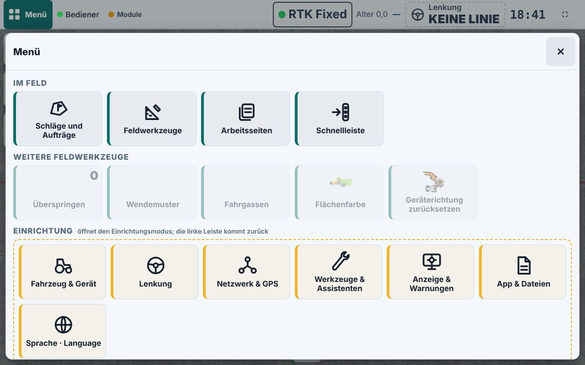 Menü: „Fahrzeug & Gerät“ ist eine Kachel unter Einrichtung, ohne Hinweis, was aktiv ist | 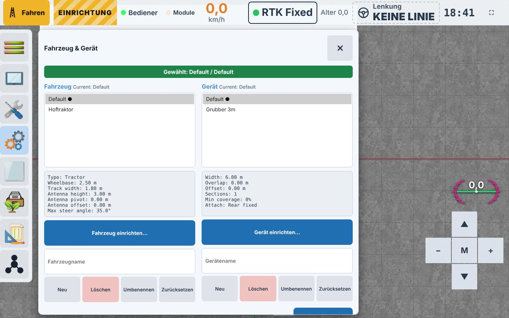 Auswahl: zwei Listen, Werte als englischer Festtext |
|  Anderes Profil markiert: Banner „Gewählt“, „Current:“ englisch | 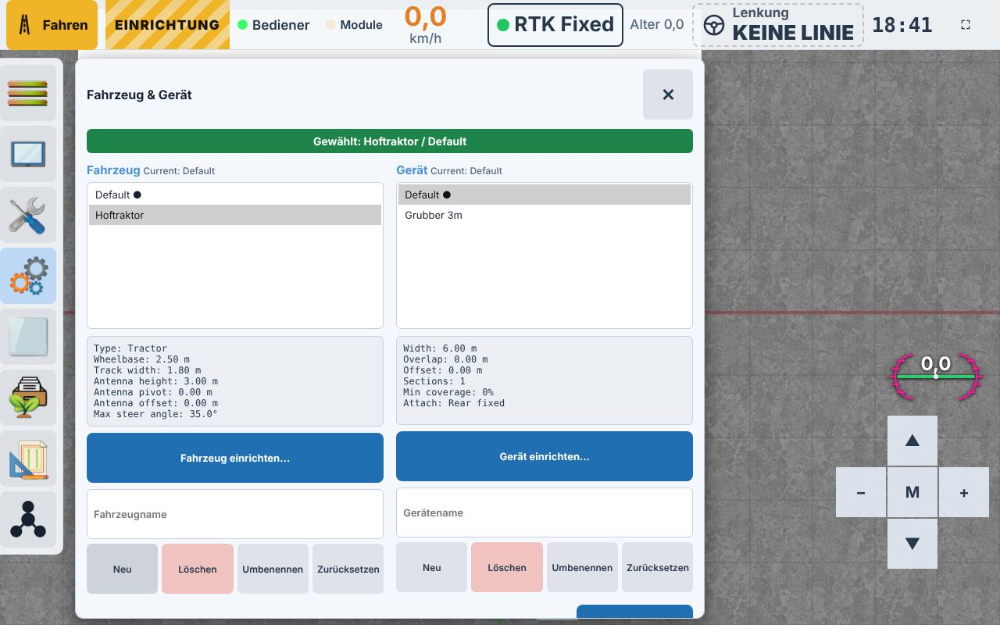 „Neu“ ohne Namen: nur ein Statustext |
| 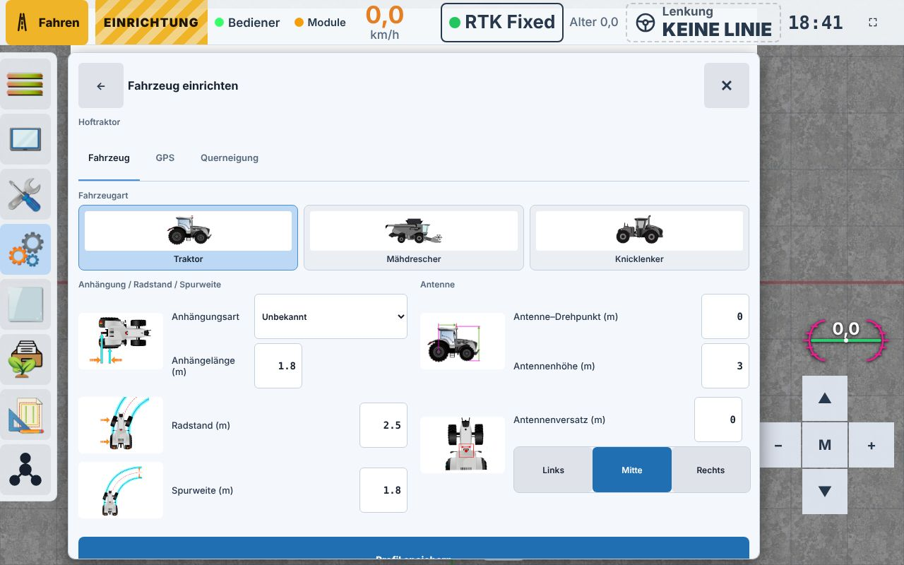 Fahrzeug einrichten: alle Maße auf einer Seite, „Profil speichern“ unter dem Rand | 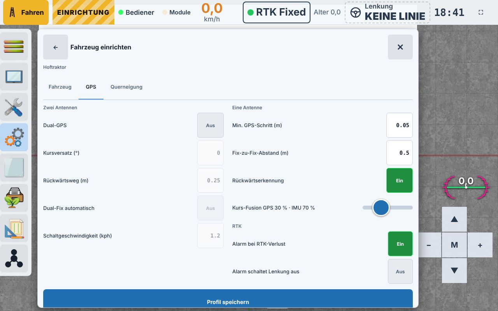 GPS-Reiter (Experten) |
| 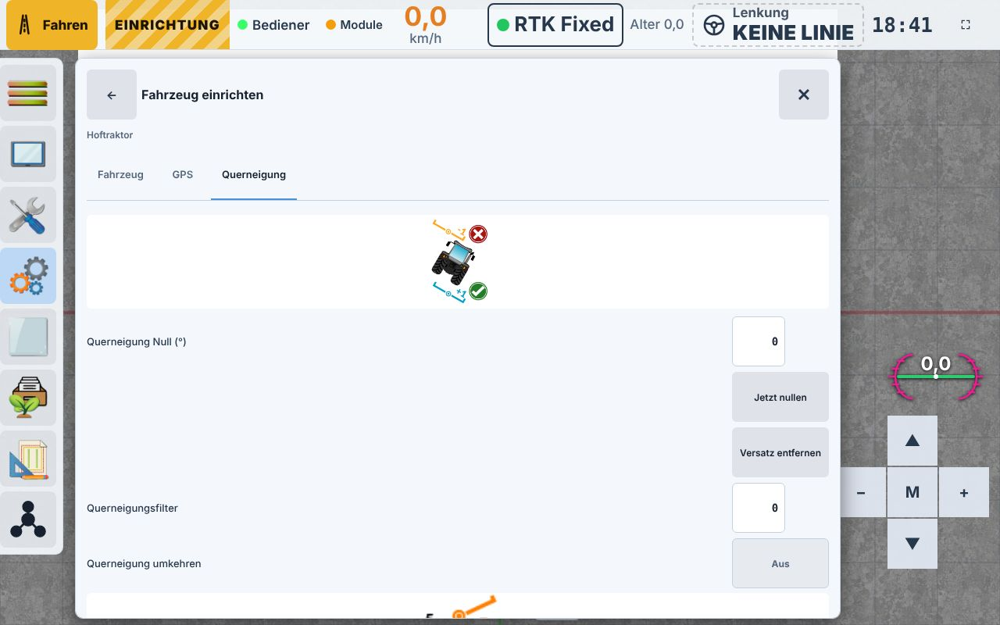 Querneigung | 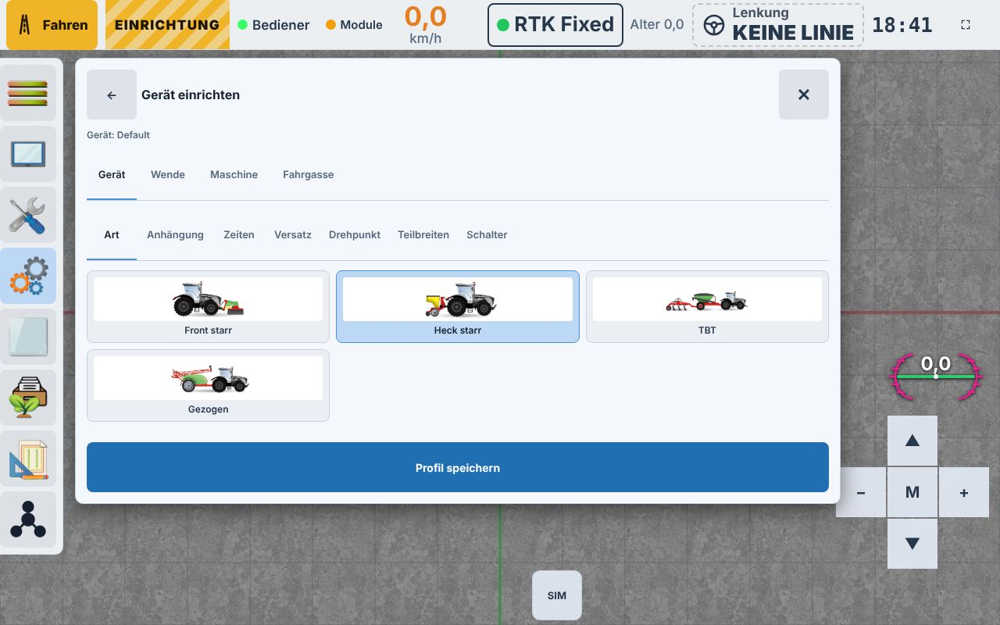 Gerät einrichten: 4 Reiter, 7 Unterreiter |
| 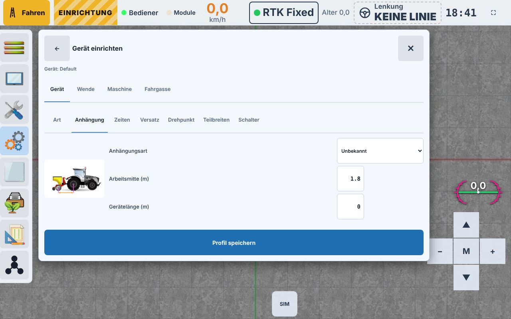 Anhängung | 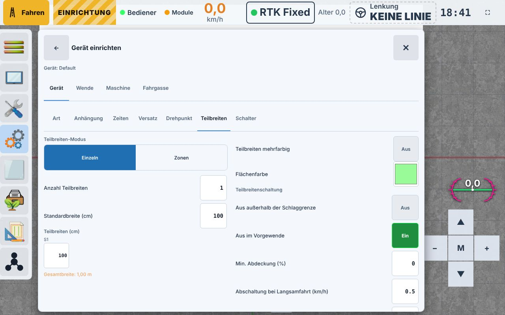 Teilbreiten: Gesamtbreite 1,00 m |
| 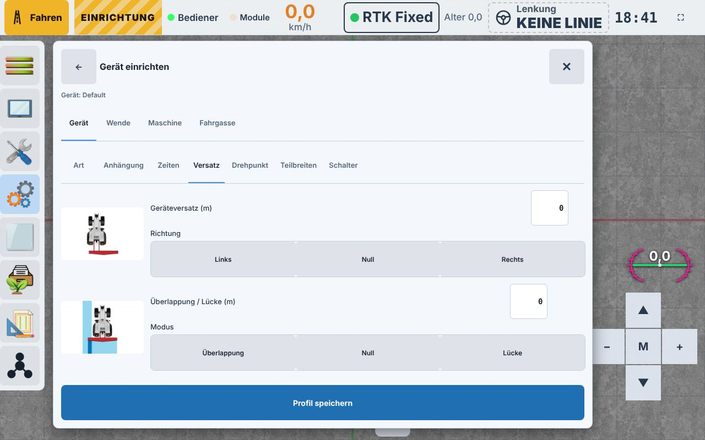 Versatz | 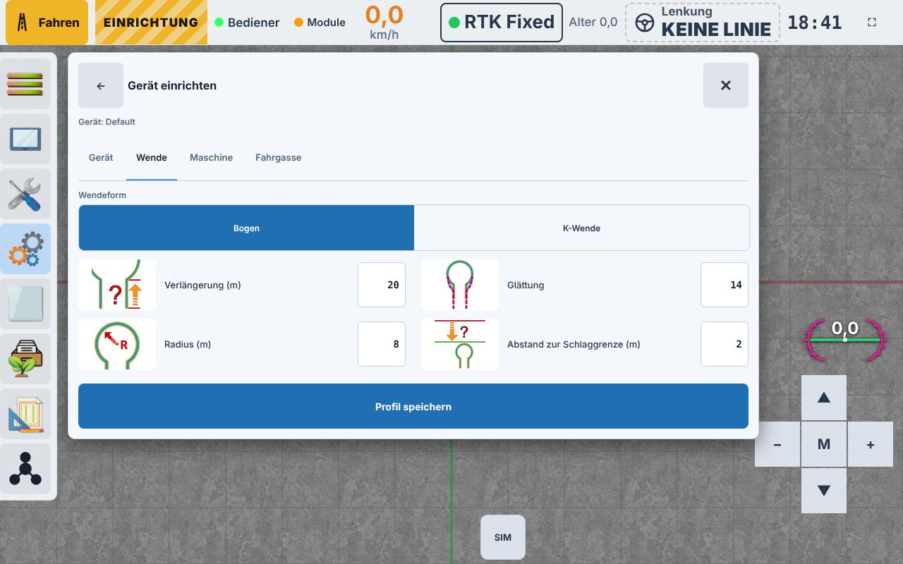 Wende (gespeichert im Fahrzeugprofil) |

| Schritt | Heute | Befehl an den Host |
|---|---|---|
| Auswählen | *Menü → Fahrzeug & Gerät*: zwei Listen (Fahrzeug / Gerät), darunter ein Textblock mit Werten vom Host, Knopf „Gewählte laden“ | `profile.load|<Fahrzeug>\t<Gerät>` (speichert vorher das aktive Paar) |
| Anlegen | Namen ins Textfeld tippen, „Neu“ | `profile.new|<vehicle/tool>\t<Name>` = **Kopie des gerade aktiven** Profils unter neuem Namen |
| Bearbeiten | „Fahrzeug einrichten…“ / „Gerät einrichten…“ öffnet Dialoge mit Reitern (Fahrzeug, GPS, Querneigung bzw. Gerät mit 7 Unterreitern, Wende, Maschine, Fahrgassen) | `profile.configureVehicle|<Name>` / `profile.configureTool|<Name>` macht das Profil aktiv; jedes Feld `config.set|<key>:<wert>`; „Profil speichern“ = `profile.save` |
| Umbenennen / Löschen | Namen tippen, Knopf | `profile.rename`, `profile.delete` |
| Zurücksetzen | nur das Profil „Default“ | `profile.reset|<vehicle/tool>` |

Wichtige Befunde:

1. **„Neu“ ist bereits „Duplizieren“.** Der Host kopiert das aktive Profil. Ein leeres
   Profil gibt es nicht (nur „Default“ zurücksetzen). Ein Assistent „Neuer Traktor“ legt also
   eine Kopie an und ändert dann die Maße. Das ist ehrlich so anzuzeigen („Startet als Kopie
   von …“), es werden keine eigenen Vorgaben erfunden.
2. **Jede Eingabe wirkt sofort.** `config.set` ändert die laufende Konfiguration, auch vor
   „Speichern“. Bearbeiten nur im Stand und bei ausgeschalteter Lenkung anbieten
   (Anzeige-Sperre, der Host bleibt unverändert).
3. **Nur das aktive Profil ist bearbeitbar.** Bearbeiten macht es vorher aktiv (wie heute).
4. **Werte nicht aktiver Profile** kommen nur als fertiger Text vom Host
   (`Wheelbase: 2.50 m` …). Die Karten zeigen diese Werte unverändert (nur das Etikett
   übersetzt, Komma statt Punkt), sie werden nicht neu berechnet oder gerundet.
5. **Geräteart (Grubber, Spritze, Sämaschine …) gibt es im Profil nicht**, nur die Anbauart
   (Front starr, Heck starr, TBT, gezogen). Fahrzeugart gibt es (Traktor, Mähdrescher,
   Knicklenker). → offene Frage, siehe 4.
6. **Wende- und Fahrgassen-Werte stehen im Gerät-Dialog, werden aber im Fahrzeugprofil
   gespeichert** (`Guidance.UTurn*`, `TramPasses`). Die Fahrgassen-Spurweite steht in
   keinem Profil (App-Einstellung). Im neuen Konzept sind sie deshalb beim Traktor bzw.
   ausdrücklich als „gilt für alle Profile“ gekennzeichnet.
7. Der Host prüft keine Werte (jede Zahl wird übernommen). Plausibilitätswarnungen sind
   reine Anzeige; es wird nie automatisch korrigiert.
8. Upstream-Kleinigkeit: „Current: …“ in der Auswahl ist fest englisch (kein `tr`).
9. **„Width“ in der Vorschau ist nicht die Arbeitsbreite.** Der Host-Text (`FormatTool`)
   zeigt `Tool.Width`, einen gespeicherten Ersatzwert (oft 6 m). Spurabstand und Wende
   rechnen mit der Summe der Teilbreiten (`ActualToolWidth`, im Client `config.tool.totalWidth`).
   Im Bild: Vorschau „Width: 6.00 m“, Teilbreiten-Reiter „Gesamtbreite: 1,00 m“. Für das
   **aktive** Gerät kennt der Client die echte Breite; für nicht aktive nur den Host-Text.
   Deshalb im Konzept: aktive Karte „Arbeitsbreite“ (= `totalWidth`), andere Karten
   „Breite lt. Profil“ (= Host-Text, unverändert). Nur berichtet, Host unverändert.
10. Im Fahrzeug-Reiter liegt „Profil speichern“ bei 1280 × 800 unter dem Rand (scrollen).
11. Eingabefelder zeigen Zahlen mit Punkt („1.8“); das ist die Eingabe, nicht die Anzeige,
    und bleibt so (Eingaben mit Komma würde der Host anders lesen).

## 2. Alle Felder

Spalten: **Pflicht** = ohne passenden Wert fährt die Lenkung falsch oder die Teilbreiten
schalten falsch; **Lenkung** = geht in Lenkung/Spurführung ein (direkt oder über Spurabstand,
Wende); **selten** = meist einmal eingerichtet oder nur für Sonderfälle.

### Fahrzeugprofil

| Feld (Schlüssel) | Einheit | Pflicht | Lenkung | selten | Bemerkung |
|---|---|---|---|---|---|
| Fahrzeugart (`vehicle.type`) | – | ja | ja | | Traktor / Mähdrescher / Knicklenker |
| Radstand (`vehicle.wheelbase`) | m | ja | **ja** | | Lenkgeometrie |
| Antenne → Hinterachse (`vehicle.antennaPivot`) | m | ja | **ja** | | Position des Drehpunkts |
| Antennenhöhe (`vehicle.antennaHeight`) | m | ja | **ja** | | Hangausgleich |
| Antenne seitlich (`vehicle.antennaOffset` + Seite) | m | ja (oft 0) | **ja** | | |
| Spurweite (`vehicle.trackWidth`) | m | nein | nein | | nur Fahrgassen / Darstellung |
| Anhängung Art / Länge (`vehicle.hitchType`, `vehicle.hitchLength`) | m | bei gezogenen Geräten | indirekt | | Geräteposition → Teilbreiten |
| Max. Lenkwinkel (Lenkung-Dialog) | ° | ja | **ja** | | im Fahrzeugprofil gespeichert |
| Dual-GPS, Kursversatz, Rückwärtsweg, Umschaltgeschwindigkeit (`gps.*`) | °/m/km/h | nur Dual | **ja** | ✓ | |
| Min. GPS-Schritt, Fix-zu-Fix, Rückwärtserkennung, Kurs-Fusion (`gps.*`) | m/– | nein | **ja** | ✓ | Experten |
| RTK-Alarm, Alarm schaltet Lenkung aus (`gps.rtkLost*`) | – | nein | **ja** (Abschaltung) | ✓ | sicherheitsrelevant |
| Querneigung Null / Filter / umkehren (`roll.*`) | °/– | nein | **ja** | ✓ | |
| Lenkregler (Vorausschau, Stanley, Pure Pursuit, Totzone …) | – | nein | **ja** | ✓ | Lenkung-Dialog, nicht Teil des Assistenten |
| Wende: Radius, Verlängerung, Abstand Grenze, Form, Glättung, Überspringen | m/– | nein | **ja** (Wendepfad) | | heute im Gerät-Dialog angezeigt |
| Fahrgassen: Spuren, Anzeige, Startspur | – | nein | nein | ✓ | |

### Geräteprofil

| Feld (Schlüssel) | Einheit | Pflicht | Lenkung | selten | Bemerkung |
|---|---|---|---|---|---|
| Anbauart (`tool.type`) | – | ja | indirekt | | Front starr / Heck starr / TBT / gezogen |
| Anhängung + Längen (`tool.hitchType`, `tool.hitchLength`, `tool.trailingHitchLength`, `tool.tankTrailingHitchLength`, `tool.length`) | m | je nach Anbauart | indirekt | | Geräteposition |
| Anzahl Teilbreiten (`tool.numSections`) | – | ja | | | |
| Teilbreiten-Breiten / Standardbreite (`tool.sectionWidth`, `tool.defaultSectionWidth`) | cm | ja | **ja** (Spurabstand) | | ergeben die Arbeitsbreite |
| Überlappung / Lücke (`tool.overlap`, Seite) | m | nein (oft 0) | **ja** (Spurabstand) | | |
| Geräteversatz (`tool.offset`, Seite) | m | nein (oft 0) | **ja** | | |
| Drehpunkt (`tool.trailingToolToPivotLength`, Seite) | m | nur gezogen/TBT | indirekt | ✓ | |
| Teilbreiten/Zonen (`tool.isSectionsNotZones`, `tool.zones`, Zonen-Enden) | – | nein | nein | ✓ | |
| Vorausschau ein/aus, Ausschaltverzögerung (`tool.lookAhead*`, `tool.turnOffDelay`) | s | nein | nein | ✓ | Teilbreiten-Zeiten |
| Aus außerhalb Grenze, Aus im Vorgewende, Min. Abdeckung, Abschaltung Langsamfahrt, Überlappung Fläche | –/%/km/h/cm | nein | nein | ✓ | Teilbreitenschaltung |
| Farben (`tool.isMultiColoredSections`, Farben) | – | nein | nein | ✓ | nur Anzeige |
| Arbeitsschalter (`tool.isWorkSwitch*`) | – | nein | nein | ✓ | |
| Lenkschalter (`tool.isSteerSwitch*`) | – | nein | **ja** (Ein/Aus) | ✓ | sicherheitsrelevant |
| Maschine: Hubwerk, Hebe-/Senkzeit, Vorausschau, Relais, User 1–4, Pins (`machine.*`) | s/– | nein | nein | ✓ | Maschinenmodul |

## 3. Konzept (Mockups `docs/images/ui-ux/phase2c/mockup-*.jpg`)

| | |
|---|---|
| 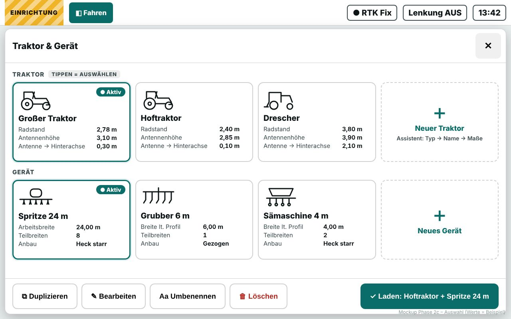 Auswahl als Karten | 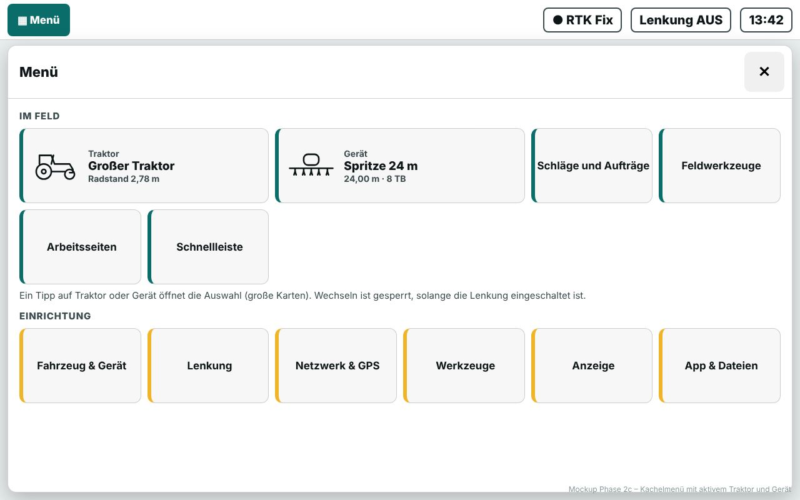 Aktiver Traktor + Gerät im Menü |
| 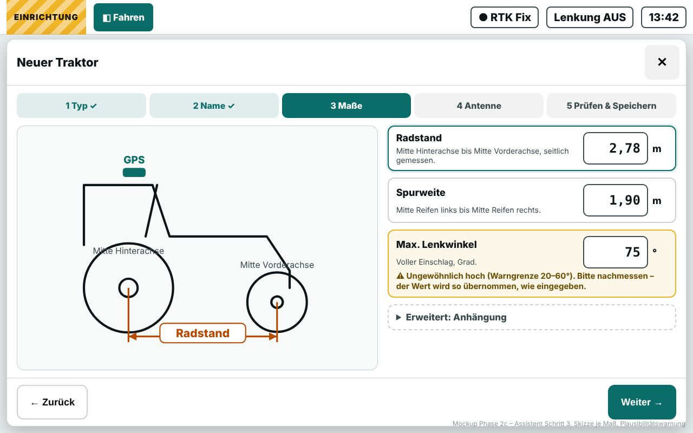 Assistent, Schritt Maße, mit Skizze und Warnung | 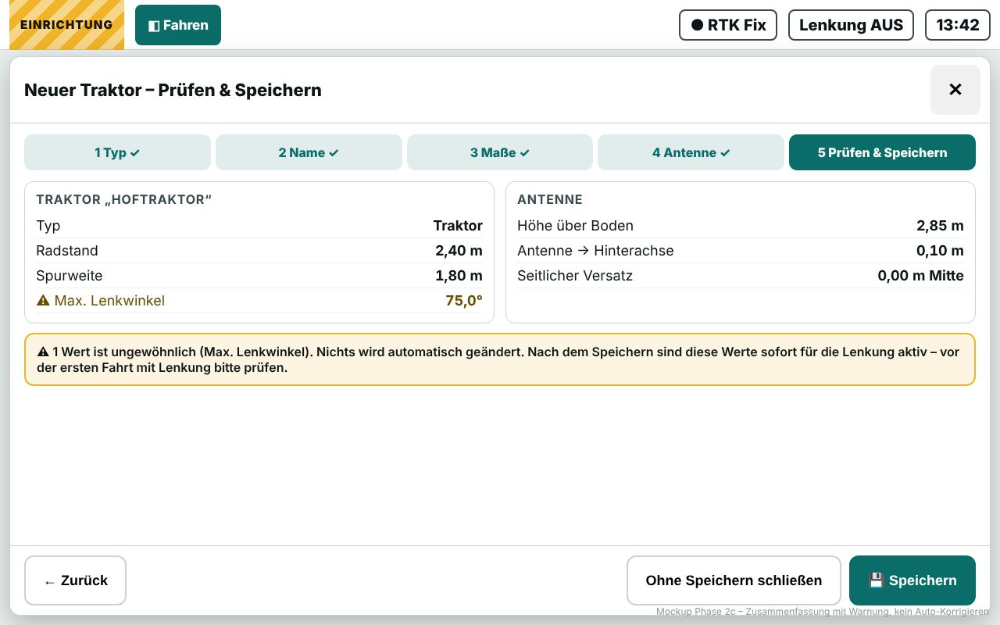 Prüfen & Speichern |

Werte und Namen in den Mockups sind Beispiele; Symbole sind eigene Strichzeichnungen.

1. **Auswahl als Karten** (Mockup *Auswahl*): je Profil eine große Karte mit Symbol, Name
   und drei Werten (Traktor: Radstand, Antennenhöhe, Antenne → Hinterachse; Gerät:
   Arbeitsbreite bzw. „Breite lt. Profil“, siehe Befund 9, Teilbreiten, Anbau), aktives Profil markiert. Tippen wählt, „Laden“ lädt
   beide (wie heute `profile.load`). Leiste: Duplizieren (`profile.new`), Bearbeiten,
   Umbenennen, Löschen (mit Rückfrage).
2. **Kachelmenü** (Mockup *Menü*): aktiver Traktor und aktives Gerät als breite Kacheln mit
   Kurzwerten; ein Tipp öffnet die Auswahl. Wechseln ist gesperrt, solange die Lenkung an ist.
3. **Assistent** (Mockups *Assistent*, *Prüfen*): Typ → Name → Maße → Antenne → Prüfen &
   Speichern; startet als Kopie des aktiven Profils (so arbeitet der Host). Pro Maß eine
   eigene Skizze, wo gemessen wird; Einheit neben jedem Feld; erst Pflichtfelder,
   „Erweitert“ eingeklappt. Gerät: Anbauart → Name → Breite/Teilbreiten → Anhängung →
   Prüfen.
4. **Plausibilitätswarnung** (gelb, mit Grund), nie Korrektur: z. B. Radstand außerhalb
   1–6 m, Antennenhöhe außerhalb 1–5 m, Max. Lenkwinkel außerhalb 20–60°, Arbeitsbreite
   außerhalb 1–60 m, Teilbreiten-Summe ≠ angezeigte Arbeitsbreite. Grenzen bitte prüfen.
5. **Bearbeiten** eines vorhandenen Profils = derselbe Assistent mit den aktuellen Werten,
   oder direkt „Alle Einstellungen“ (die heutigen Dialoge bleiben erreichbar).
6. **Host-Texte übersetzen (Zusatzpunkt):** bekannte feste Texte bei der Anzeige übersetzen:
   Fix (`No Fix`, `GPS Fix`, `DGPS Fix`, `RTK Fixed`, `RTK Float`, `Unknown`) und
   NTRIP-Status (`Not Connected`, `Disconnected`, `Connected`, `Connected to …`,
   `Connecting to …`, `Connection failed: …`, `Rejected: …`, `… — reconnecting…`, `Caster sent
   an invalid reply`). Nur der feste Teil wird übersetzt, Adressen und Caster-Antworten bleiben
   wörtlich; unbekannte Texte bleiben englisch.

## 4. Offene Fragen an dich

1. **Gerätesymbol (Grubber, Spritze, Sämaschine …):** Das Profil hat dafür kein Feld.
   Möglichkeiten ohne neue Felder: (a) Symbol aus dem Namen raten („Spritze …“ → Spritze),
   sonst Anbauart-Symbol; (b) Symbol pro Gerät auf dem Tablet merken (localStorage, nur auf
   diesem Gerät); (c) nur Anbauart-Symbole. Vorschlag: (a) + (b).
2. **Warngrenzen** in 3.4: passen die Bereiche für deine Maschinen?
3. **Bearbeiten nur im Stand / bei Lenkung AUS sperren** – einverstanden?
4. **Breite nicht aktiver Geräte** (Befund 9): „Breite lt. Profil“ aus dem Host-Text zeigen,
   oder bei nicht aktiven Geräten gar keine Breite (nur Teilbreiten + Anbau)?
5. **„Traktor“ oder „Fahrzeug“** als Überschrift? Der Host kennt auch Mähdrescher und
   Knicklenker; Vorschlag: „Fahrzeug“ in Texten, Symbol je Fahrzeugart.

## 5. Entscheidungen und Umsetzung

Antworten auf die offenen Fragen:

1. Gerätesymbol: aus dem Namen geraten; eine Auswahl im Assistenten wird nur auf diesem Tablet
   gemerkt (`aow.ui.toolIcon.<Name>`).
2. Warngrenzen: Radstand 1–6 m, Antennenhöhe 1–5 m, Antenne → Hinterachse über 4 m, Antenne
   seitlich über 0,5 m, max. Lenkwinkel 20–60° (nur angezeigt), Arbeitsbreite 1–60 m. Gelb,
   gespeichert wird der eingegebene Wert.
3. Sperre: Wechseln, Bearbeiten, Anlegen, Duplizieren, Umbenennen, Löschen und der Assistent
   (Speichern) nur im Stand (unter 0,5 km/h) und bei Lenkung AUS, und nur mit Verbindung.
4. Breite nicht aktiver Geräte: weggelassen.
5. Überschrift „Fahrzeug“.

Umsetzung (nur `wwwroot`, Block `TabletProfiles` am Ende von `app.js`):

- **Der Assistent sendet nichts, solange er offen ist.** Alle Eingaben bleiben im Client.
  „Abbrechen“ und Schließen senden nichts; das aktive Profil bleibt exakt, wie es war.
- **Speichern** schickt alle Befehle in einem Zug (ein JavaScript-Durchlauf, der Host arbeitet
  sie der Reihe nach ab):
  - neues Profil: `profile.new|<Art>\t<Name>` (Kopie des aktiven), `profile.configureVehicle|<Name>`
    bzw. `profile.configureTool|<Name>` (macht die Kopie aktiv), dann `config.set` für jeden
    geänderten Wert, zuletzt `profile.save`. Das bisherige Profil wird nicht verändert.
  - aktives Profil bearbeiten: `config.set` für jeden geänderten Wert, dann `profile.save`.
  - Nur geänderte Werte werden gesendet; die Felder nutzen dieselben Umrechnungen wie die
    Einrichtungsdialoge (`writeUnitInput` / `readUnitInput`, gleiche Schrittweite).
  - Neue Teilbreiten bekommen wie im Host die Standardbreite und werden nur gesendet, wenn sie
    geändert wurden.
- **Bestätigung:** „Gespeichert“ erst, wenn Config- und Profil-Frame des Hosts alle Werte und den
  Profilnamen zeigen und die Verbindung danach noch 1 s steht.
- **Verbindungsabriss beim Speichern** (getestet: Socket nach dem ersten bzw. zweiten Befehl
  geschlossen): Meldung „Verbindung beim Speichern abgerissen, nicht sicher, dass alles
  gespeichert wurde“. Nach der Wiederverbindung zeigt der Assistent, ob die Werte da sind, und
  bietet „Erneut senden und speichern“ (dieselben absoluten Werte; ein schon angelegtes neues
  Profil wird nicht noch einmal angelegt) und beim Bearbeiten „Alte Werte wiederherstellen“
  (die Werte von vorher, genau wie der Host sie geschickt hatte, dann `profile.save`). Beim
  neuen Profil bleibt das bisherige Profil in jedem Fall unverändert.
  Grenze: Ein Teilzustand liegt bis dahin nur im Speicher des Hosts. Lädt man in diesem Zustand
  ein anderes Profil, speichert der Host das ausgehende Paar vorher (so arbeitet `profile.load`).
- Der max. Lenkwinkel wird nur angezeigt (eingestellt wird er unter Lenkung).
- Ein Mähdrescher nimmt nur „Front starr“ (Host, #111); der Assistent zeigt das an.
- Bearbeiten und Duplizieren gehen beim aktiven Profil (der Host kennt nur dessen Werte);
  Löschen nicht beim aktiven.
- „Alle Einstellungen“ öffnet die bisherigen Dialoge, „Klassische Ansicht“ die alte Auswahl.

## Anhang: `toolWidthM()` mit 6-m-Ersatzwert im Client

`toolWidthM()` (app.js) nimmt die Breite aus den Teilbreiten der Szene (linke bis rechte Kante)
und fällt auf **6 m** zurück, wenn die Szene keine Teilbreiten hat. Alle Aufrufer liegen im
Upstream-Code, außerhalb des tablet-ui-Blocks. In Phase 2c geändert (klein, `fork:`-Kommentar,
siehe [Host-Aenderungen.md](Host-Aenderungen.md) Abschnitt 3): Schlag-Editor und Leistung
nutzen `sectionsWidthM()` ohne Ersatzwert; ohne Teilbreiten bleibt das Abstandsfeld leer
(„Arbeitsbreite fehlt“) und die Leistung zeigt „—“. Hilfslinien und Raster unverändert.

| Stelle | Wofür | Wirkung des Ersatzwerts |
|---|---|---|
| `fbDefaultOffset()` | Schlag-Editor, Vorgewende-Abstand vorbelegt = 2 × Breite | 12 m statt richtiger Breite; nur Vorbelegung im Feld, der Bediener sieht und ändert sie vor dem Senden |
| `fbApplyTw()` | Schlag-Editor, „N Arbeitsbreiten“ ins Abstandsfeld | **wird an den Host gesendet**, wenn man es so übernimmt: Vorgewende 6 m × N statt echter Breite |
| Statuszeile „Leistung“ (ha/h) | Anzeige | falsche Leistung |
| `drawExtraGuidelinesSk` | Hilfslinien auf der Karte | Abstand der Hilfslinien falsch (nur Anzeige) |
| Raster der Karte | Rasterabstand | nur Anzeige |

Normalfall: mit geladenem Gerät hat die Szene Teilbreiten, dann greift der Ersatzwert nicht.
Unsere Breiten-Kachel (Phase 2) nutzt `config.tool.totalWidth` und ist nicht betroffen.
